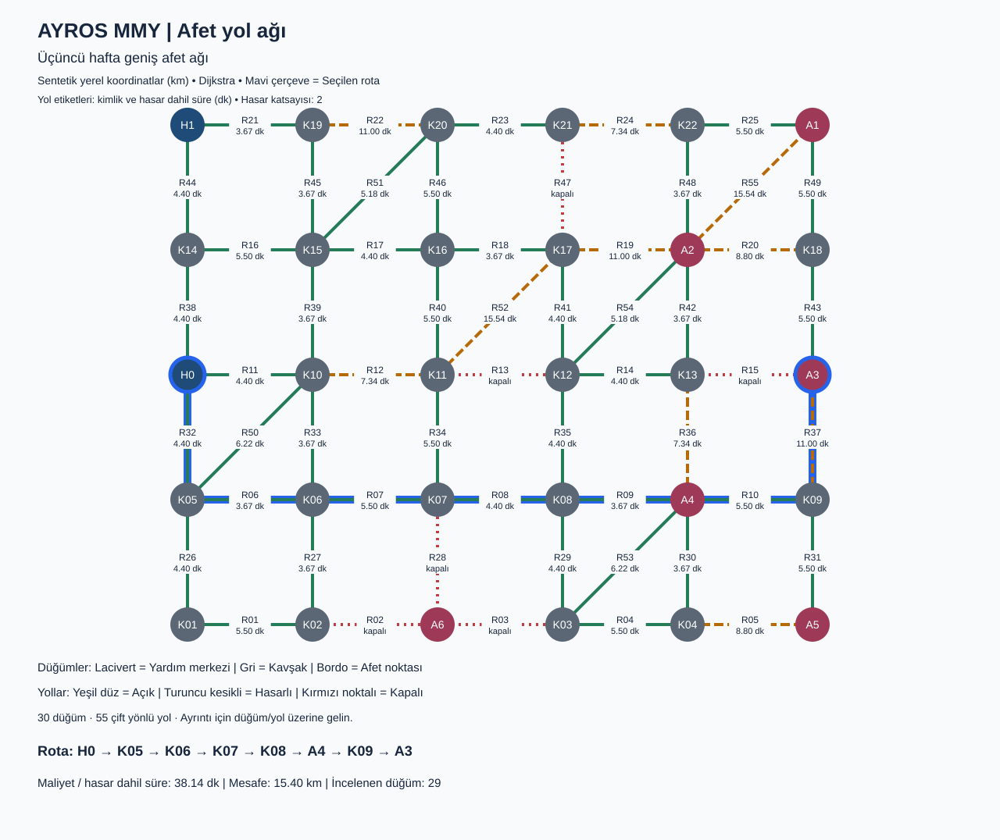

<h1 align="center">AYROS MMY</h1>
<p align="center">Afet Yardım Rota Optimizasyon Sistemi</p>

AYROS MMY, simüle edilmiş afet bölgelerinde yardım araçlarının yol koşulları ve ihtiyaç öncelikleri dikkate alınarak yönlendirilmesi amacıyla geliştirilecek bir akademik projedir. Dijkstra ve A* algoritmalarıyla rota hesaplama, değişen yol koşullarına göre yeniden planlama ve temel düzeyde çoklu araç görev dağıtımı hedeflenmektedir.

> **Proje durumu — 3. hafta:** Dijkstra artık **30 düğüm, 55 yollu** ağ üzerinde çalışıyor. 2 yardım merkezi ve 6 afet noktası için tek hedef rotası veya toplu erişilebilirlik özeti alınabiliyor. **44 otomatik test başarılıdır.** Bu haftanın takım kaptanı **Yusuf Öksüz**. A*, araç atama ve hareket sonraki aşamalardır. [Üçüncü hafta notu ve sunum akışı](docs/hafta3.md)

## Proje Hakkında

Afet sonrasında yolların hasar görmesi veya ulaşıma kapanması, yardım araçlarının afet noktalarına erişimini güçleştirebilir. AYROS MMY kapsamında, bu koşulların simüle edildiği bir yol ağı üzerinde yardım araçları için uygun rotaların hesaplanması planlanmaktadır.

Afet bölgesi **ağırlıklı çizge (weighted graph)** olarak modellenecektir. Kavşaklar, yardım merkezleri ve afet noktaları düğümleri; bu noktaları birbirine bağlayan yollar ise kenarları oluşturacaktır. Her yol için mesafe, tahmini geçiş süresi ve yol durumu gibi bilgiler tutulacaktır.

## Projenin Amacı

Projenin amacı, yardım araçlarının yönlendirilmesinde yalnızca en kısa mesafeyi değil; yol durumunu, tahmini seyahat süresini ve afet noktalarının aciliyetini de dikkate alan bir sistem geliştirmektir.

Bu doğrultuda yol koşullarının rota maliyetine yansıtılması, afet noktalarının ihtiyaçlarına göre önceliklendirilmesi ve araçların uygun hedeflere atanması hedeflenmektedir. Önceliklendirme ve görev dağıtımı hedef seçimini destekleyecek; rota algoritmaları ise seçilen hedefe ulaşmak için tanımlanan yol maliyetleri üzerinden çalışacaktır.

## Planlanan Özellikler

- **Çizge tabanlı afet simülasyonu:** Kavşak, yardım merkezi ve afet noktalarından oluşan bir yol ağı oluşturulması.
- **Yol bilgilerinin tutulması:** Her yolun mesafesinin, tahmini geçiş süresinin ve açık, hasarlı veya kapalı olma durumunun modellenmesi.
- **Yol koşullarına duyarlı maliyet hesabı:** Kapalı yolların rota hesabından çıkarılması ve hasarlı yolların rota maliyetinin artırılması.
- **İki rota algoritması:** Dijkstra ve A* algoritmalarının uygulanması ve karşılaştırılması.
- **Sezgisel rota arama:** A* için modelin uygun olduğu durumlarda Öklid uzaklığı gibi sezgisel yöntemlerin değerlendirilmesi.
- **Dinamik yeniden planlama:** Yol kapanması veya maliyet değişimi durumunda ilgili rotaların yeniden hesaplanması.
- **Afet noktalarının önceliklendirilmesi:** Yaralı sayısı, afetzede sayısı ve aciliyet seviyesi gibi verilerin değerlendirilmesi.
- **Temel görev dağıtımı:** Birden fazla yardım aracının uygun afet noktalarına atanması.
- **Senaryo üretimi:** Farklı düğüm ve yol sayıları, kapalı veya hasarlı yol oranları, araç sayıları ve afet öncelik seviyeleri içeren senaryolar hazırlanması.
- **Performans analizi:** Rota maliyeti, tahmini seyahat süresi, algoritma çalışma süresi ve incelenen düğüm sayısının ölçülmesi.

## Sistem Akışı

```text
Afet bölgesi simülasyonu
          |
          v
Düğümlerin ve yolların oluşturulması
          |
          v
Yol durumlarının belirlenmesi
          |
          v
Afet noktalarının önceliklendirilmesi
          |
          v
Araçların afet noktalarına atanması
          |
          v
Dijkstra / A* ile rota hesaplama
          |
          v
Rotanın oluşturulması
          |
          v
Yol durumunda veya maliyetinde değişiklik
          |
          v
Gerekiyorsa yeniden rota hesaplama
```

## Kullanılacak Algoritmalar

### Dijkstra

Dijkstra uygulaması seçilen başlangıç ve hedef arasında en düşük süre maliyetli rotayı bulur. Açık yolun maliyeti temel süresidir; hasarlı yolun süresi varsayılan olarak 2 ile çarpılır. Kapalı yollar aramaya dahil edilmez. `heapq` yalnızca öncelik kuyruğu için kullanılır; arama ve rotanın geri kurulması proje kodundadır.

Dijkstra, aynı senaryolarda A* ile karşılaştırılacak temel rota algoritmalarından biri olacaktır.

### A*

A* algoritması, başlangıçtan bir düğüme ulaşmanın maliyetini, o düğümden hedefe kalan maliyetin sezgisel tahminiyle birlikte değerlendirir:

```text
f(n) = g(n) + h(n)
```

- **g(n):** Başlangıç düğümünden n düğümüne kadar bulunan yolun maliyeti.
- **h(n):** n düğümünden hedefe ulaşmak için kalan maliyetin sezgisel tahmini.
- **f(n):** n düğümü üzerinden hedefe ulaşmanın tahmini toplam maliyeti.

Düğümlerin konum bilgileri ve seçilen maliyet modeli uygun olduğunda Öklid uzaklığı gibi sezgisel yöntemler değerlendirilecektir. Sezgisel fonksiyonun rota maliyetiyle uyumlu birimde olması ve en düşük maliyetli rotayı bulma güvencesi için kalan maliyeti olduğundan yüksek tahmin etmemesi gözetilecektir. Kullanılacak sezgisel yöntem, sistem modeli netleştikçe belirlenecektir.

## Yol Modeli

- **Açık:** Maliyet = `travel_time_min`.
- **Hasarlı:** Maliyet = `travel_time_min × damaged_factor`.
- **Kapalı:** Aramadan çıkarılır; senaryo verisinde korunur.

Hasar katsayısı varsayılan **2** olan, en az **1** seçilebilen bir simülasyon varsayımıdır; ölçülmüş saha verisi değildir. Mesafe kilometre, maliyet dakika cinsindedir ve birbirine eklenmez. Toplam mesafe ayrı raporlanır. Hasar dahil tahmini süre ile rota maliyeti bu modelde aynı değerdir; temel süre ise hasar etkisi hariç toplamdır.

## Afet Noktalarının Önceliklendirilmesi

Afet noktalarının değerlendirilmesinde aşağıdaki verilerin kullanılması planlanmaktadır:

- Yaralı sayısı.
- Afetzede sayısı.
- Aciliyet seviyesi.
- İlgili noktaya ulaşım maliyeti.

Bu veriler, yardım ihtiyacının önceliğini ve araçların hangi noktalara yönlendirileceğini belirlemede kullanılacaktır. **Kesin bir matematiksel öncelik formülü henüz belirlenmemiştir.** Ölçütlerin ağırlıkları ve birlikte nasıl değerlendirileceği, proje tasarımı ve simülasyon senaryoları doğrultusunda ele alınacaktır.

## Performans Karşılaştırması

Dijkstra ve A* algoritmalarının aynı yol ağı, başlangıç ve hedef noktaları ile aynı maliyet modeli kullanılarak karşılaştırılması planlanmaktadır.

| Metrik | Değerlendirilecek ölçüt |
| --- | --- |
| **Rota maliyeti** | Hesaplanan rotadaki kenar maliyetlerinin toplamı. |
| **Tahmini seyahat süresi** | Rotadaki yolların tahmini geçiş sürelerinin toplamı. |
| **Algoritma çalışma süresi** | Rota hesaplama işleminin tamamlanması için geçen süre. |
| **İncelenen düğüm sayısı** | Arama sırasında incelenen düğümlerin, iki algoritma için ortak bir sayım tanımıyla ölçülen sayısı. |

Deneylerde düğüm ve yol sayıları, kapalı veya hasarlı yol oranları, araç sayıları ve afet öncelik seviyeleri değiştirilecektir. Bu bölüm karşılaştırma planını açıklamaktadır; henüz deney sonucu veya bir algoritmanın üstünlüğüne ilişkin bir bulgu sunulmamaktadır.

## Kullanılacak Teknolojiler

| Teknoloji | Planlanan kullanım |
| --- | --- |
| **Python** | Simülasyon modelinin, rota algoritmalarının, temel görev dağıtımının ve performans ölçümlerinin geliştirilmesi. |

Algoritmaların mümkün olduğunca proje ekibi tarafından geliştirilmesi hedeflenmektedir. Görselleştirme ve analiz için kullanılabilecek Python kütüphaneleri ilerleyen aşamalarda değerlendirilecektir; henüz belirli bir kütüphane veya framework seçilmemiştir.

## İleri Aşama Hedefleri

Projenin kapsamı ve geliştirme süresi elverirse aşağıdaki olası geliştirmeler değerlendirilebilecektir:

- **Araç Rotalama Problemi (Vehicle Routing Problem — VRP):** Birden fazla aracın ve ziyaret edilecek noktaların birlikte ele alındığı yaklaşımların incelenmesi.
- **Gelişmiş çoklu araç atama:** Temel görev dağıtımının ötesinde, araçlar arasındaki görev paylaşımının geliştirilmesi.
- **Daha büyük simülasyonlar:** Daha fazla düğüm, yol, araç ve afet noktası içeren senaryoların denenmesi.
- **Gelişmiş görselleştirme:** Yol durumlarının, afet önceliklerinin ve rota değişimlerinin daha ayrıntılı gösterilmesi.

Bu başlıklar gelecekteki olası geliştirmelerdir; tamamlanmış işlevleri veya mevcut aşamada kesinleşmiş teslimleri ifade etmemektedir.

## Proje Durumu

İkinci haftada Python veri modeli ve küçük bir afet senaryosu oluşturuldu. Senaryo **10 düğüm ve 14 çift yönlü yol** içerir: **9 açık, 3 hasarlı, 2 kapalı yol**. Düğümler 1 yardım merkezi, 6 kavşak ve 3 afet noktasından oluşur.

Üçüncü haftanın ana senaryosu **30 düğüm ve 55 çift yönlü yol** içerir: **2 yardım merkezi, 6 afet noktası, 22 kavşak; 39 açık, 10 hasarlı, 6 kapalı yol**. 6×5 yerleşimde yatay/dikey yollar ve 6 çapraz bağlantı vardır. A6'nın üç giriş yolu kapalı olduğundan her iki merkezden de 6 afet noktasının 5'ine ulaşılabilir.

H0 → A3 rotası varsayılan hasar katsayısıyla **38,14 dakika** maliyet, **32,64 dakika** temel süre ve **15,40 km** mesafe verir. Katsayı 1 yapılınca farklı rota **31,24 dakika** olur. İki merkezin hedefleri ayrı ayrı sorgulanır; otomatik merkez/araç ataması yapılmaz. Elle anlatım için 4 düğümlü örnek ve önceki haftanın 10 düğümlü verisi korunmuştur. **44 test metodu başarılıdır** (19 Ekim 2026).

## Çalıştırma

Python **3.11 veya üzeri** yeterlidir. Bu sürüm yalnızca standart kütüphaneyi kullanır; ek paket kurulumu gerekmez. Komutları depo klasöründe çalıştırın:

```bash
py -3.11 -m ayros --start H0 --target A3 --svg docs/hafta3_genis_rota.svg
py -3.11 -m ayros --start H0 --all-targets
py -3.11 -m ayros --start H1 --all-targets
py -3.11 -m ayros --start H0 --target A3 --damage-factor 1 --svg docs/hafta3_hasar_1.svg
py -3.11 -m ayros --start H0 --target A6
py -3.11 -m unittest discover -s tests -v
```

Komutlar Windows Python başlatıcısını kullanır. Diğer sistemlerde `py -3.11` yerine Python 3.11+ yorumlayıcınızın `python` veya `python3` komutunu kullanın. Varsayılan veri `data/hafta3_genis_ag.json` dosyasıdır. İlk komutun SVG çıktısını tarayıcıda açın; yol etiketlerinde kimlik ve güncel süre, üzerine gelince ayrıntılar görünür. `--all-targets` tüm afet noktalarını bağımsız hesaplar ve bazıları erişilemez olsa da tamamlanan özet için `0` döndürür. Tek hedefte ulaşılamayan sonuç `3`, veri/dosya hatası `1`, hatalı komut kullanımı `2` koduyla biter.

Küçük örnek: `py -3.11 -m ayros data/hafta3_ornek.json --start S --target T`. Önceki haftanın ağı: `py -3.11 -m ayros data/hafta2_senaryo.json --start H0 --target A1`. Geniş veri dosyası `py -3.11 scripts/generate_week3_scenario.py` ile aynı şekilde yeniden üretilebilir.



## Dosyalar ve hafta notları

- `ayros/model.py`: Düğüm, yol ve yönsüz komşuluk listesi.
- `ayros/scenario.py`: JSON okuma ve veri kontrolleri.
- `ayros/routing.py`: Maliyet modeli, Dijkstra ve rota ölçümleri.
- `ayros/__main__.py`: Terminalde senaryo ve rota çıktısı.
- `ayros/visualize.py`: Veriden SVG üretimi ve seçilen rotanın gösterilmesi.
- `data/hafta2_senaryo.json`: Tekrarlanabilir örnek senaryo.
- `tests/test_scenario.py`: Model, dosya okuma, görsel ve komut satırı testleri.
- `data/hafta3_ornek.json`: Elle doğrulanabilen rota örneği.
- `data/hafta3_genis_ag.json`: Sunumun ana senaryosu; 30 düğüm, 55 yol.
- `scripts/generate_week3_scenario.py`: Geniş ağın tekrarlanabilir veri üretimi.
- `tests/test_routing.py`: Rota doğruluğu, sınır durumları, CLI ve SVG kontrolleri.
- `tests/test_large_scenario.py`: Geniş ağda bağımsız maliyet doğrulaması ve toplu sorgular.
- [Üçüncü hafta: maliyet modeli, doğrulama ve sunum](docs/hafta3.md)
- [Veri sözlüğü ve sunum adımları](docs/hafta2.md)
- [Gereksinim analizi](docs/gereksinimler.md)

Koordinatlar yerel düzlemde kilometre cinsindedir; gerçek enlem/boylam değildir. İlk modelde yollar çift yönlüdür; aynı iki düğüm arasında tek yol desteklenir. Bağlantısız ağlar geçerlidir, boş düğüm listesi reddedilir. Ayrıntılı kapsam ve sonraki adım hafta notunda açıklanmıştır.

## Ekip

**3. hafta takım kaptanı: Yusuf Öksüz.**

| Ad Soyad |
| --- |
| Mert Aydın |
| Yusuf Öksüz |
| Muhammet ALTINOLUK |

## Akademik Bağlam

Bu proje, **Fırat Üniversitesi Mühendislik Fakültesi Bilgisayar Mühendisliği** bünyesinde, **Bilgisayar Mühendisliği Tasarım Dersi** kapsamında geliştirilmektedir.

**Akademik proje başlığı:** Simüle Edilmiş Afet Bölgesinde Yardım Araçları İçin Rota Planlama

---

AYROS MMY — Afet Yardım Rota Optimizasyon Sistemi
