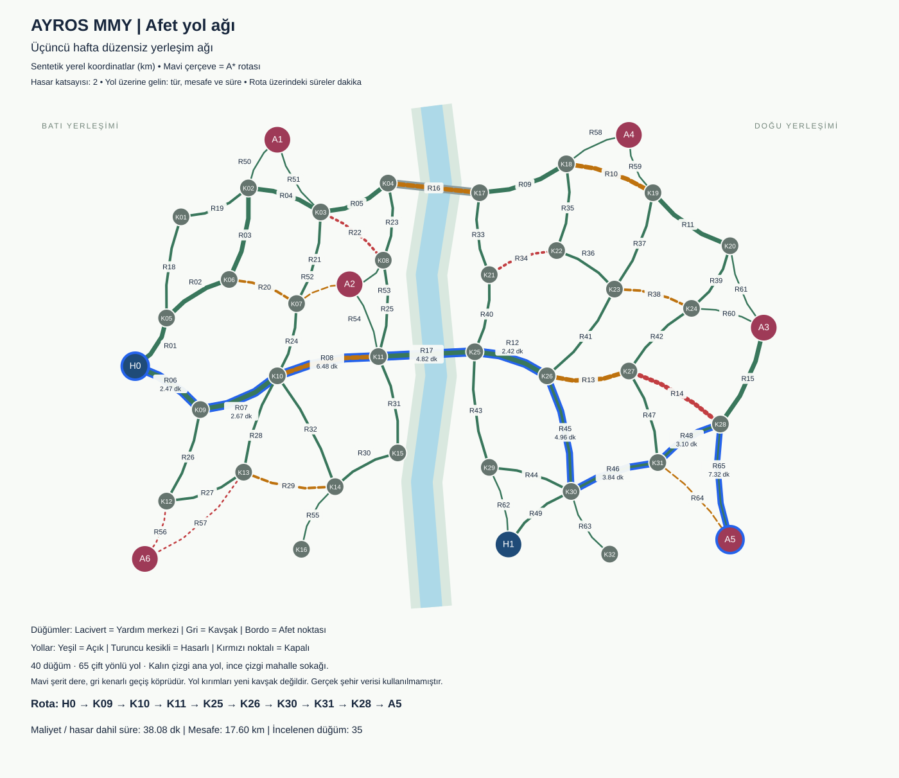
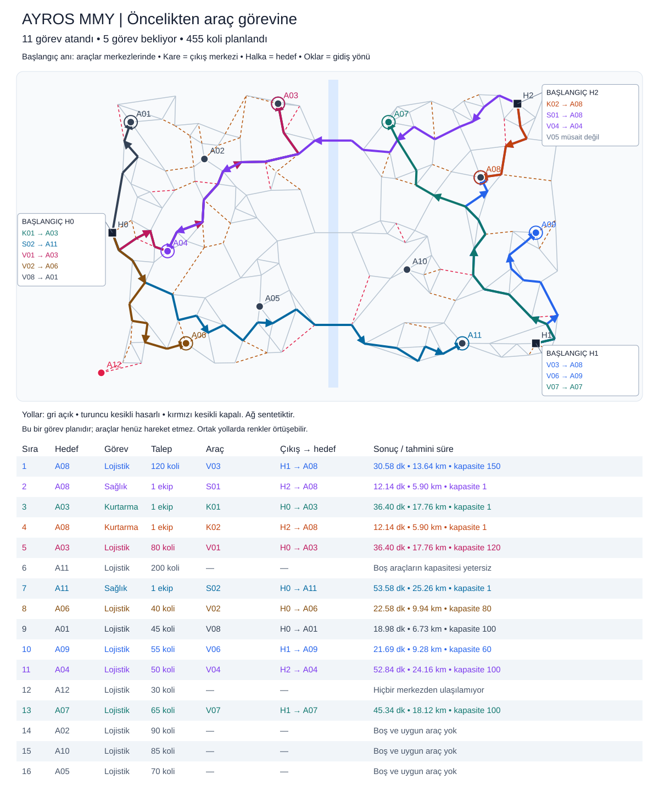
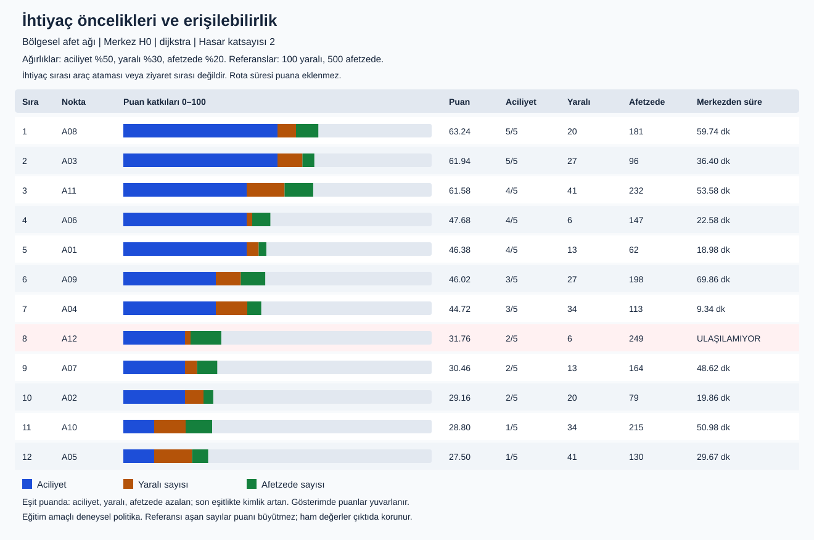
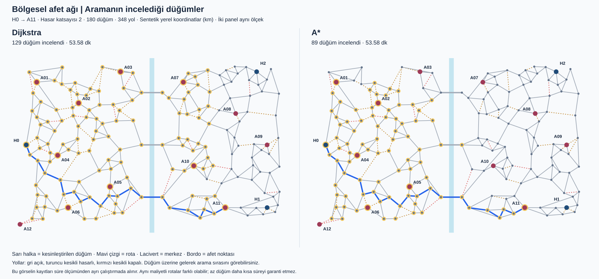

<h1 align="center">AYROS MMY</h1>
<p align="center"><strong>Afet Yardım Rota Optimizasyon Sistemi</strong></p>
<p align="center">Python ile çizge modelleme, yol koşullarına duyarlı rota hesabı ve SVG görselleştirme.</p>

AYROS MMY, simüle edilmiş bir afet bölgesinde yardım merkezlerinden afet noktalarına ulaşım rotaları hesaplayan bir akademik projedir. Dijkstra ve A* algoritmaları, açık ve hasarlı yolların tahmini geçiş sürelerini değerlendirerek en düşük süre maliyetli rotayı bulur; kapalı yolları aramaya dahil etmez.

Afet noktaları ayrıca aciliyet, yaralı ve etkilenen kişi sayısına göre açıklanabilir bir ihtiyaç puanıyla sıralanır. Merkezden erişilebilirlik ve rota süresi bu puandan ayrı gösterilir.

6. hafta geliştirmesi, ihtiyaç sırasındaki hedeflere kapasitesi yeterli ve müsait araçları atar. Her araç ilk turda tek görev alır; sonuçlar rota haritası ve açıklamalı JSON olarak üretilebilir. Bu çalışma şu anda yerel `hafta-6-arac-atama` dalındadır; aşağıdaki klonlama adımları yayımlanmış 5. hafta sürümünü açar.

**Mevcut sürüm:** Komut satırı uygulaması · Python 3.11+ · Yalnızca standart kütüphane

[Hızlı başlangıç](#hızlı-başlangıç) · [Kullanım](#kullanım) · [Algoritmalar](#algoritmalar-ve-karşılaştırma) · [Yol modeli](#yol-modeli) · [Testler](#testler) · [Yol haritası](#yol-haritası)

Güncel geliştirme: [6. hafta araç atama sürümü](https://github.com/AYROS-MMY/afet-yardim-rota-planlama/tree/hafta-6-arac-atama).

## Önizleme



Mavi çerçeve seçilen rotayı gösterir. Yeşil yollar açık, turuncu kesikli yollar hasarlı, kırmızı noktalı yollar kapalıdır. SVG dosyasını tarayıcıda açarak yolların üzerine geldiğinizde tür, mesafe ve süre ayrıntılarını görebilirsiniz.

## Özellikler

- **Dijkstra ve A* ile rota hesabı:** Başlangıç ve hedef seçimi; rota, toplam maliyet, temel süre ve mesafe çıktısı.
- **Tekrarlı karşılaştırma:** Aynı sorguda eşit maliyet kontrolü, incelenen düğümler ve medyan hesaplama süresi.
- **Yol koşullarının modellenmesi:** Değiştirilebilir hasar katsayısı ve kapalı yolların elenmesi.
- **Toplu erişilebilirlik sorgusu:** Bir merkezden bütün afet noktalarına bağımsız rota hesabı.
- **Geometri içeren senaryolar:** Düzensiz mahalleler, ana yollar, ara sokaklar, çıkmazlar ve köprüler.
- **SVG çıktısı:** Yol durumları, yol sınıfları, seçilen rota ve maliyet açıklamaları.
- **Veri doğrulama:** Geçersiz kimlikler, ölçümler, bağlantılar ve yol geometrileri için açıklayıcı hatalar.
- **Arama ölçümleri:** Maliyeti kesinleştirilen düğüm sayısı ve rota hesaplama süresi.
- **Arama görselleri:** İki algoritmanın kesinleştirdiği düğümler aynı ölçekte yan yana gösterilir.
- **İhtiyaç önceliklendirme:** Değiştirilebilir ağırlıklar, sabit referanslar ve kararlı eşitlik kurallarıyla 0–100 puan.
- **Açıklanabilir çıktılar:** Her ölçütün puan katkısı, erişilemeyen noktalar, JSON dışa aktarım ve SVG karşılaştırması.

## Hızlı başlangıç

Git ve Python **3.11 veya üzeri** kurulu olmalıdır. Ek Python paketi kurulumu gerekmez.

```bash
git clone https://github.com/AYROS-MMY/afet-yardim-rota-planlama.git
cd afet-yardim-rota-planlama
```

Güncel uygulama henüz geliştirme dalındadır:

```bash
git switch hafta-6-arac-atama
```

Windows'ta proje klasöründeki terminalden çalıştırın:

```powershell
py -3.11 -m ayros --start H0 --target A5 --algorithm astar --svg output/rota.svg
```

macOS/Linux üzerinde aynı komutta `py -3.11` yerine Python 3.11+ yorumlayıcınızın `python3` komutunu kullanın. Oluşan `output/rota.svg` dosyasını tarayıcıda açın. `output/` klasörü gerektiğinde oluşturulur ve Git takibine alınmaz.

Varsayılan senaryoda beklenen sonuç:

```text
Rota: H0 -> K09 -> K10 -> K11 -> K25 -> K26 -> K30 -> K31 -> K28 -> A5
Maliyet / hasar dahil tahmini süre: 38.08 dk
Temel süre (hasar etkisi hariç): 34.84 dk
Toplam mesafe: 17.60 km
```

## Kullanım

### İhtiyaç türüne göre görev dağıtımı

6. hafta araç atama dalında, proje klasöründen çalıştırın:

```powershell
py -3.11 -m ayros.dispatch --json output/hafta6_atama.json --svg output/hafta6_atama.svg --html output/hafta6_araclar.html
```

`output/hafta6_araclar.html` dosyasını tarayıcıda açın. Bölge panelinden **A08** seçildiğinde üç bağımsız ihtiyaç görünür: 120 koli lojistik, bir sağlık ekibi ve bir kurtarma ekibi. Bölgenin rotalarını göster düğmesi yalnızca o bölgeye atanan araçları gösterir. Soldan araç seçimi tek rotayı gösterir; tüm görevler bütün rotaları geri getirir. Kareler çıkış merkezlerini, halkalar hedefleri, oklar gidiş yönünü gösterir. Bu ekran başlangıç planıdır; henüz hareketli simülasyon değildir.



Varsayılan `data/gorev_senaryosu_12_arac.json`, **12 araç ve 16 görev** içerir. **11 görev atanır:** 7 lojistik görevde 455 koli, 2 sağlık ve 2 kurtarma ekibi görevi. A08'e V03 (lojistik), S01 (sağlık) ve K02 (kurtarma) atanır. K01 daha acil A03 görevindedir. A11 lojistik görevi kapasite nedeniyle beklerken sağlık görevi S02'ye atanır. A12 erişilemez; üç lojistik görevde boş araç kalmaz. Bir görev atanması teslimat gerçekleştiği anlamına gelmez.

Özet kartlarında **930 koli ihtiyaç, 455 koli planlanan yük ve 475 koliye henüz araç atanmadığı** ayrı gösterilir. Araç kartları planlanan yük/kapasite bilgisini içerir. Tekrarlanabilir başlangıç kaydı: [6. hafta deney çıktısı](docs/deneyler/hafta6_baslangic.json).

9 araçlı karşılaştırma sürümü `--fleet data/gorev_senaryosu.json` ile korunmuştur: 8 görev ve 340 koli.

Karar sırası: **görev aciliyeti → bölge ihtiyaç puanı → hedef/görev kimliği**. Uygun türde, boş, müsait, yeterli kapasiteli ve erişebilir araçlar arasından en kısa süreli olan seçilir; eşit sürede araç kimliği kullanılır. Lojistik birimi standart kolidir. Sağlık/kurtarma araçları bir ekip görevini taşır; hasta tahliyesi veya kurtarma başarısı hesaplanmaz. Aciliyet ve miktarlar sentetik senaryo girdileridir; yaralı sayısından otomatik türetilmez.

```powershell
py -3.11 -m ayros.dispatch --algorithm dijkstra
py -3.11 -m ayros.dispatch --fleet data/arac_senaryosu.json
py -3.11 -m ayros.dispatch --help
```

İkinci komut eski, yalnızca koli içeren sürüm 1 senaryosunu çalıştırır (5 atama, 340 koli). Yeni sürüm 2 şeması ve kısıtlar [araç atama yönteminde](docs/arac_atama.md) açıklanır. `--scenario`, `--fleet`, `--priority-policy`, `--damage-factor` girdileri değiştirir. Çıktıların girdiler üzerine yazılması engellenir. Çıkış kodları: başarılı değerlendirme **0**, veri/dosya hatası **1**, hatalı komut **2**. Bazı görevlerin atanamaması tamamlanan değerlendirmenin hatası değildir.

Yöntem tek turluk açgözlü atamadır; global filo optimumunu veya en fazla göreve hizmeti garanti etmez. Stok, çoklu sefer, bölünmüş teslimat ve hareket henüz modellenmez.

### İhtiyaç öncelikleri

```powershell
py -3.11 -m ayros data/bolgesel_ag.json --start H0 --prioritize --priority-svg output/oncelik.svg --priority-json output/oncelik.json
```



Varsayılan politikada ilk üç nokta **A08: 63,24**, **A03: 61,94**, **A11: 61,58** puandır. A12 **31,76** puanla listede kalır; iki girişi kapalı olduğu için erişimi ayrıca **ULAŞILAMIYOR** olarak gösterilir. Puan sırası araç ataması veya ziyaret sırası değildir.

Formül: `100 × [0,50 × aciliyet/5 + 0,30 × min(yaralı/100, 1) + 0,20 × min(afetzede/500, 1)]`.

Ağırlıklar ve 100/500 referansları eğitim amaçlı başlangıç varsayımlarıdır; kurum onaylı karar ölçütleri değildir. Aciliyet 1–5 aralığında olduğundan en düşük aciliyet de puana katkı verir. Yaralı sayısı afetzede sayısının bir alt kümesidir; ayrı katkı yaralı ihtiyacına ek ağırlık vermek içindir.

`data/oncelik_politikasi.json` dosyasının bir kopyasını düzenleyip `--priority-policy DOSYA` ile kullanabilirsiniz. Ağırlıklar 0–1 aralığında ve toplamları 1; referanslar pozitif tam sayı olmalıdır. Sabit referanslar sayesinde başka bir hedefin eklenmesi mevcut puanları değiştirmez. Referansı aşan katkılar doyurulur, ham sayılar JSON'da korunur. Eşit puanda aciliyet, yaralı ve afetzede sayıları azalan, son eşitlikte kimlik artan sırada değerlendirilir. Sıralama yuvarlanmamış puanlarla yapılır.

```powershell
py -3.11 -m ayros data/bolgesel_ag.json --start H1 --prioritize --algorithm astar --priority-policy data/oncelik_politikasi.json
py -3.11 scripts/analyze_priorities.py
```

Deney iki ağda üç politika, her merkez, iki hasar katsayısı ve iki algoritmayla **60 değerlendirme ve 576 hedef kaydı** üretir. Aynı politikada merkez, yol maliyeti ve algoritma değişse de ihtiyaç sırası korunur. Etkilenen kişi sayısına daha yüksek ağırlık veren örnekte bölgesel ağın ilk hedefi A11 olur. Ayrıntılar: [Önceliklendirme yöntemi](docs/onceliklendirme.md).

### Rota ve algoritma karşılaştırması

Algoritmayı seçin veya aynı sorguda ikisini karşılaştırın:

```powershell
py -3.11 -m ayros --start H0 --target A5 --algorithm dijkstra
py -3.11 -m ayros --start H0 --target A5 --algorithm astar
py -3.11 -m ayros --start H0 --target A5 --compare --repeats 50
```

Algoritma belirtilmezse Dijkstra kullanılır. `--compare` iki algoritmayı çalıştırır; bu seçenek `--algorithm` ve `--svg` ile birlikte kullanılmaz. `--repeats` yalnızca karşılaştırma için geçerlidir ve 1–1000 arasında seçilir; varsayılanı 30'dur.

Seçilen merkezden bütün afet noktalarını sorgulayın:

```powershell
py -3.11 -m ayros --start H0 --all-targets
py -3.11 -m ayros --start H1 --all-targets
py -3.11 -m ayros --start H0 --all-targets --algorithm astar
py -3.11 -m ayros --start H0 --all-targets --compare --repeats 50
```

Hasarın ek süre etkisini kaldırarak rota seçimini karşılaştırın:

```powershell
py -3.11 -m ayros --start H0 --target A5 --damage-factor 1 --svg output/hasar_1.svg
```

Bu sorgu farklı bir rota üzerinden **28,90 dakika** ve **15,18 km** verir. [Karşılaştırma görseli](docs/hafta3_hasar_1.svg) depoda hazır bulunur. Katsayının 1 olması kapalı yolları açmaz.

Kendi JSON senaryonuzu veya küçük doğrulama örneğini çalıştırın:

```powershell
py -3.11 -m ayros data/hafta3_ornek.json --start S --target T
py -3.11 -m ayros --help
```

`--all-targets`, her hedef için ayrı sonuç üretir; ziyaret sırası veya araç ataması yapmaz. SVG üretimi için tek bir hedef seçilmelidir. Ulaşılamayan hedefte “Rota bulunamadı” mesajı verilir. Çıkış kodları: başarı **0**, veri/dosya hatası **1**, komut kullanımı hatası **2**, tek hedefe ulaşılamaması **3**. Toplu sorgu tamamlandığında bazı hedefler erişilemez olsa da çıkış kodu **0** olur.

## Yol modeli

### Büyük ağ ve arama görselleştirme

İkinci senaryo **180 düğüm, 348 yol, 3 merkez ve 12 afet noktası** içerir. Önceki 40 düğümlü ağ varsayılan olarak korunur. Büyük ağı karşılaştırmak ve iki aramanın incelediği düğümleri görmek için:

```powershell
py -3.11 -m ayros data/bolgesel_ag.json --start H0 --target A11 --compare --repeats 50 --search-svg output/arama.svg
```

`output/arama.svg` dosyasını tarayıcıda açın. Sarı halkalar **maliyeti kesinleştirilen** düğümleri, mavi çizgi bulunan rotayı gösterir. Düğüm üzerine gelince sıra numarası okunur. Bu kayıtlar süre deneyinden ayrı iki sorguda alınır; `--search-svg` yalnızca `--compare` ve tek hedefle kullanılır. Erişilemeyen hedefin arama görseli de üretilebilir.



H0 → A11, hasar katsayısı 2 örneğinde iki algoritma da **53,575 dakika** bulur (terminalde iki basamakla **53,58** gösterilir). Dijkstra **129**, A* **89** düğüm inceler. [40 düğümlü ağdaki arama görünümü](docs/kucuk_ag_arama.svg) de mevcuttur. Görseller araç hareketi göstermez.

Senaryonun tasarımı ve sonraki özelliklerde nasıl kullanılacağı [deney rehberinde](docs/deneyler.md) açıklanır.

### Yol maliyeti ve senaryo verisi

Yol ağı, çift yönlü ve ağırlıklı bir çizgedir. Düğümler yardım merkezi, kavşak veya afet noktası; kenarlar bu noktaları bağlayan yollardır. Dijkstra ve A* uygulamaları proje kodundadır; `heapq` yalnızca öncelik kuyruğu olarak kullanılır.

- **Açık yol:** Maliyet temel geçiş süresidir.
- **Hasarlı yol:** Maliyet, temel süre × hasar katsayısıdır. Katsayı varsayılan olarak **2**, en az **1** olur.
- **Kapalı yol:** Senaryo verisinde tutulur, rota aramasında kullanılmaz.

Maliyet birimi **dakika**, mesafe birimi **kilometredir**. En düşük süre maliyeti aranır; mesafe ayrı raporlanır. Hasar dahil tahmini süre ile rota maliyeti bu modelde aynı değerdir. Afet ihtiyaçları öncelik sırasını ve araç atamasında hedeflerin ele alınma sırasını belirler; tek bir rotanın yol maliyetine eklenmez.

Ana senaryo `data/hafta3_genis_ag.json` dosyasıdır:

- **40 düğüm:** 2 yardım merkezi, 6 afet noktası ve 32 kavşak.
- **65 yol:** 51 açık, 9 hasarlı ve 5 kapalı yol.
- **İki köprü:** Derenin ayırdığı yakaları birbirine bağlar.
- **Erişim örneği:** A6'nın iki girişi de kapalıdır; her merkezden 6 afet noktasının 5'ine ulaşılır.

Yolun isteğe bağlı `via` koordinatları geometrisini, `road_type` alanı sınıfını belirler. Ara geometri noktaları yeni kavşak oluşturmaz. Mesafeler çizilen yol parçalarının toplamından hesaplanır. Temel süreler ana yol, ikincil yol, sokak ve köprü için sırasıyla **40, 30, 20 ve 25 km/saat** varsayımlarına dayanır.

Koordinatlar yerel düzlemdedir; gerçek enlem/boylam değildir. Ağ, hızlar ve hasar katsayısı sentetiktir; gerçek şehir veya canlı saha verisi kullanılmaz. Her komut sabit bir senaryoyu çözer.

Senaryoyu aynı verilerle yeniden üretmek için:

```powershell
py -3.11 scripts/generate_week3_scenario.py
```

## Algoritmalar ve karşılaştırma

Dijkstra, başlangıçtan gelen birikmiş süreyi (`g`) kullanır. A*, buna hedefe kalan sürenin alt sınırını (`h`) ekleyerek `f = g + h` değeriyle öncelik verir. İki terim de **dakikadır**. Hedef ilk görüldüğünde değil, öncelik kuyruğundan alındığında arama biter.

A* tahmini `h(n) = alpha × Öklid(n, hedef)` biçimindedir. `alpha`, geçilebilir yolların **süre maliyeti / uçlar arasındaki kuş uçuşu mesafe** oranlarının en küçüğüdür. Böylece her kenarda `alpha × mesafe ≤ maliyet` sağlanır; üçgen eşitsizliği tahmini tutarlı kılar. Kapalı yollar hesaba katılmaz. Aynı koordinattaki uçlar oran hesabında atlanır; güvenli bir ölçek üretilemezse `h = 0` kullanılır. Bu seçim farklı hızlara sahip eski JSON senaryolarını da destekler. A*'ın teorik temeli için [Hart, Nilsson ve Raphael'in çalışması](https://www.cs.auckland.ac.nz/courses/compsci709s2c/resources/Mike.d/astarNilsson.pdf) incelenebilir.

Ölçümler her algoritma için **2 ısınma çalıştırmasından** sonra alınır. Algoritmaların sırası her turda değiştirilir; sonuçta **medyan** süre gösterilir. Maliyet ve A* tahmini hazırlama, arama ve rotayı geri kurma süreye dahildir. JSON okuma, terminal çıktısı ve SVG üretimi dahil değildir. İncelenen düğüm sayısı, kuyruktan alınıp maliyeti kesinleştirilen benzersiz düğümlerdir; başlangıç ve erişilen hedef de sayılır. Eşit maliyetli birden fazla rota varsa düğüm dizileri farklı olabilir.

İki merkez × altı hedef × iki hasar katsayısı deneyini yeniden çalıştırın:

```powershell
py -3.11 scripts/compare_algorithms.py --repeats 50
```

`output/algorithm_comparison.json`, 24 sorgunun rotalarını, düğüm sayılarını, ham süre örneklerini ve medyanlarını içerir. Python/platform bilgisi, UTC ölçüm zamanı ve senaryonun SHA-256 özeti de kaydedilir. Bu üretilen dosya Git'e eklenmez.

Birden fazla ağı aynı deneyde çalıştırmak için `--scenario` tekrar edilebilir:

```powershell
py -3.11 scripts/compare_algorithms.py --scenario data/hafta3_genis_ag.json --scenario data/bolgesel_ag.json --repeats 50 --output output/ag_karsilastirma.json
```

Bu komut **96 sorgu** üretir: ilk ağda 24, bölgesel ağda 72. JSON sürüm 2'de `scenarios` her ağın kimliğini, boyutunu ve SHA-256 özetini tutar; her sonuç kendi `scenario` alanını taşır. Tek ağda eski üst düzey `scenario` ve `scenario_sha256` alanları da korunur.

**Yerel deney sonucu (Python 3.11.4, Windows, 50 tekrar):** 40 düğümlü ağda 20 erişilebilir sorgunun minimum maliyetleri aynı, A6'ya yönelik 4 sorgu erişilemezdir. Düğüm sayılarının toplamı Dijkstra için **669**, A* için **474** oldu (yaklaşık **%29 azalma**). 180 düğümlü ağda 66 erişilebilir sorgunun maliyetleri aynı, A12'ye yönelik 6 sorgu erişilemezdir. Toplamlar **7203 ve 5094** oldu (yaklaşık **%29 azalma**). Her ağdaki erişilebilir sorguların tamamında A* daha az düğüm inceledi.

Sorgu medyanlarının aritmetik ortalaması 40 düğümlü ağda yaklaşık **0,088 / 0,104 ms**, 180 düğümlü ağda **0,409 / 0,501 ms** oldu (Dijkstra / A*). Bunlar tek bir birleşik medyan değildir. Hazırlık dahil bu deneyde A* iki ağda da toplam sürede üstünlük göstermedi. Süreler bilgisayarın yüküne göre değişir. İki farklı topoloji, genel bir ölçeklenme veya karmaşıklık kanıtı değildir; düğüm sayısı yanında yol sayısı ve ağ yapısı da değişmektedir.

## Proje yapısı

```text
ayros/       Çizge, rota, ihtiyaç önceliği, araç atama, CLI ve JSON/SVG üretimi
data/        Çalıştırılabilir senaryolar ve küçük doğrulama örneği
docs/        Proje görselleri ve mevcut teknik notlar
scripts/     Tekrarlanabilir senaryo üretimi ve karşılaştırma deneyi
tests/       Veri modeli, rota doğruluğu, geometri ve CLI testleri
```

## Testler

```powershell
py -3.11 -m unittest discover -s tests -v
```

**125 test metodu**, veri doğrulama, kapalı yollar, hasar etkisi, ulaşılamayan hedefler, yol geometrisi, köprü kapanmaları, SVG ve komut satırı davranışlarını kapsar. Önceki 48 küçük ağ sorgusu bağımsız tam yol taramasıyla kontrol edilir. A* için 12 sabit tohumlu küçük ağdaki **144 sorgu**, 40 düğümlü ağdaki **24 sorgu** ve bölgesel ağdaki **72 sorgu** bağımsız Bellman–Ford hesabıyla karşılaştırılır. Tahminin tutarlılığı, arama kayıtlarının sonuçları değiştirmemesi, SVG düğümlerinin tam kayda eşitliği, düzlemsel topoloji, köprü kapanmaları ve çoklu ağ deney dosyası ayrıca sınanır. Döngü içindeki sorgular test metodu sayısına eklenmez. Önceliklendirme için eklenen 23 test; puan hesabı, 300 bağımsız rasyonel örnek, monotonluk, doygunluk, eşitlik, erişim bağımsızlığı, JSON/SVG ve CLI hata durumlarını kapsar.

Araç ataması için 35 yeni test; hizmet türü, görev aciliyeti, bağımsız bölge ihtiyaçları, koli/ekip birimleri, eski şema uyumluluğu, kapasite, müsaitlik, tek görev, eşitlik, erişim gerekçeleri, A*/Dijkstra uyumu, JSON/SVG eşleşmesi, girdi koruması ve açgözlü yöntemin karşı örneğini kapsar.

Hesaplama süresi maliyet hazırlama, arama ve rota kurmayı içerir; dosya okuma ve SVG üretimini içermez. Tek çalıştırmanın süresi karşılaştırmalı performans sonucu olarak değerlendirilmez.

## Yol haritası

- [x] Çizge modeli ve JSON senaryo doğrulama
- [x] Dijkstra, yol durumu maliyeti ve erişilebilirlik sorguları
- [x] Geometri içeren yol ağı ve SVG rota görselleştirme
- [x] A* ve aynı koşullarda algoritma karşılaştırması
- [x] Afet noktalarının açıklanabilir ihtiyaç puanı ve merkezden erişim değerlendirmesi
- [x] Temel çoklu araç görev dağıtımı (tek tur, kapasite ve müsaitlik)
- [ ] Yol koşulları değiştiğinde otomatik yeniden planlama

9. hafta final teslimine yönelik kabul ölçütleri: [Kalan haftaların planı](docs/yol_haritasi.md).

## Ekip ve akademik bağlam

**Muhammet Altınoluk · Mert Aydın · Yusuf Öksüz**

Fırat Üniversitesi, Mühendislik Fakültesi, Bilgisayar Mühendisliği — Bilgisayar Mühendisliği Tasarım Dersi.

**Akademik proje başlığı:** Simüle Edilmiş Afet Bölgesinde Yardım Araçları İçin Rota Planlama.
