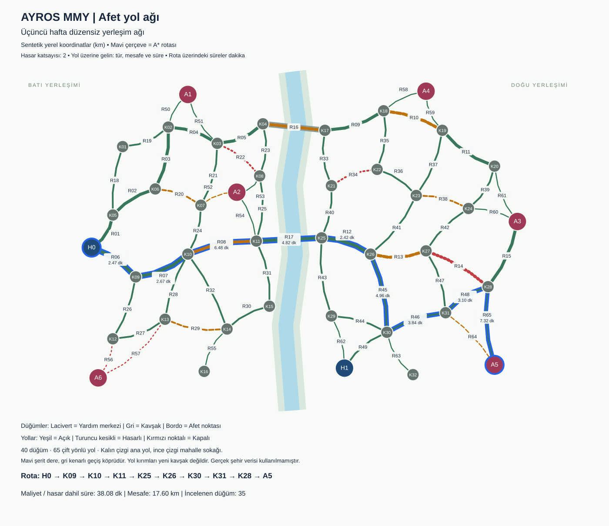

<h1 align="center">AYROS MMY</h1>
<p align="center"><strong>Afet Yardım Rota Optimizasyon Sistemi</strong></p>
<p align="center">Python ile çizge modelleme, yol koşullarına duyarlı rota hesabı ve SVG görselleştirme.</p>

AYROS MMY, simüle edilmiş bir afet bölgesinde yardım merkezlerinden afet noktalarına ulaşım rotaları hesaplayan bir akademik projedir. Dijkstra ve A* algoritmaları, açık ve hasarlı yolların tahmini geçiş sürelerini değerlendirerek en düşük süre maliyetli rotayı bulur; kapalı yolları aramaya dahil etmez.

**Mevcut sürüm:** Komut satırı uygulaması · Python 3.11+ · Yalnızca standart kütüphane

[Hızlı başlangıç](#hızlı-başlangıç) · [Kullanım](#kullanım) · [Algoritmalar](#algoritmalar-ve-karşılaştırma) · [Yol modeli](#yol-modeli) · [Testler](#testler) · [Yol haritası](#yol-haritası)

## Önizleme



Mavi çerçeve seçilen rotayı gösterir. Yeşil yollar açık, turuncu kesikli yollar hasarlı, kırmızı noktalı yollar kapalıdır. SVG dosyasını tarayıcıda açarak yolların üzerine geldiğinizde tür, mesafe ve süre ayrıntılarını görebilirsiniz.

## Özellikler

- **Dijkstra ve A* ile rota hesabı:** Başlangıç ve hedef seçimi; rota, toplam maliyet, temel süre ve mesafe çıktısı.
- **Tekrarlı karşılaştırma:** Aynı sorguda eşit maliyet kontrolü, incelenen düğümler ve medyan hesaplama süresi.
- **Yol koşullarının modellenmesi:** Değiştirilebilir hasar katsayısı ve kapalı yolların elenmesi.
- **Toplu erişilebilirlik sorgusu:** Bir merkezden bütün afet noktalarına bağımsız rota hesabı.
- **Geometri içeren senaryolar:** Düzensiz mahalleler, ana yollar, ara sokaklar, çıkmazlar ve köprüler.
- **SVG çıktısı:** Yol durumları, yol sınıfları, seçilen rota ve maliyet açıklamaları.
- **Veri doğrulama:** Geçersiz kimlikler, ölçümler, bağlantılar ve yol geometrileri için açıklayıcı hatalar.
- **Arama ölçümleri:** Maliyeti kesinleştirilen düğüm sayısı ve rota hesaplama süresi.

## Hızlı başlangıç

Git ve Python **3.11 veya üzeri** kurulu olmalıdır. Ek Python paketi kurulumu gerekmez.

```bash
git clone https://github.com/AYROS-MMY/afet-yardim-rota-planlama.git
cd afet-yardim-rota-planlama
```

Güncel uygulama henüz geliştirme dalındadır:

```bash
git switch hafta-4-astar
```

Windows'ta proje klasöründeki terminalden çalıştırın:

```powershell
py -3.11 -m ayros --start H0 --target A5 --algorithm astar --svg output/rota.svg
```

macOS/Linux üzerinde aynı komutta `py -3.11` yerine Python 3.11+ yorumlayıcınızın `python3` komutunu kullanın. Oluşan `output/rota.svg` dosyasını tarayıcıda açın. `output/` klasörü gerektiğinde oluşturulur ve Git takibine alınmaz.

Varsayılan senaryoda beklenen sonuç:

```text
Rota: H0 -> K09 -> K10 -> K11 -> K25 -> K26 -> K30 -> K31 -> K28 -> A5
Maliyet / hasar dahil tahmini süre: 38.08 dk
Temel süre (hasar etkisi hariç): 34.84 dk
Toplam mesafe: 17.60 km
```

## Kullanım

Algoritmayı seçin veya aynı sorguda ikisini karşılaştırın:

```powershell
py -3.11 -m ayros --start H0 --target A5 --algorithm dijkstra
py -3.11 -m ayros --start H0 --target A5 --algorithm astar
py -3.11 -m ayros --start H0 --target A5 --compare --repeats 50
```

Algoritma belirtilmezse Dijkstra kullanılır. `--compare` iki algoritmayı çalıştırır; bu seçenek `--algorithm` ve `--svg` ile birlikte kullanılmaz. `--repeats` yalnızca karşılaştırma için geçerlidir ve 1–1000 arasında seçilir; varsayılanı 30'dur.

Seçilen merkezden bütün afet noktalarını sorgulayın:

```powershell
py -3.11 -m ayros --start H0 --all-targets
py -3.11 -m ayros --start H1 --all-targets
py -3.11 -m ayros --start H0 --all-targets --algorithm astar
py -3.11 -m ayros --start H0 --all-targets --compare --repeats 50
```

Hasarın ek süre etkisini kaldırarak rota seçimini karşılaştırın:

```powershell
py -3.11 -m ayros --start H0 --target A5 --damage-factor 1 --svg output/hasar_1.svg
```

Bu sorgu farklı bir rota üzerinden **28,90 dakika** ve **15,18 km** verir. [Karşılaştırma görseli](docs/hafta3_hasar_1.svg) depoda hazır bulunur. Katsayının 1 olması kapalı yolları açmaz.

Kendi JSON senaryonuzu veya küçük doğrulama örneğini çalıştırın:

```powershell
py -3.11 -m ayros data/hafta3_ornek.json --start S --target T
py -3.11 -m ayros --help
```

`--all-targets`, her hedef için ayrı sonuç üretir; ziyaret sırası veya araç ataması yapmaz. SVG üretimi için tek bir hedef seçilmelidir. Ulaşılamayan hedefte “Rota bulunamadı” mesajı verilir. Çıkış kodları: başarı **0**, veri/dosya hatası **1**, komut kullanımı hatası **2**, tek hedefe ulaşılamaması **3**. Toplu sorgu tamamlandığında bazı hedefler erişilemez olsa da çıkış kodu **0** olur.

## Yol modeli

Yol ağı, çift yönlü ve ağırlıklı bir çizgedir. Düğümler yardım merkezi, kavşak veya afet noktası; kenarlar bu noktaları bağlayan yollardır. Dijkstra ve A* uygulamaları proje kodundadır; `heapq` yalnızca öncelik kuyruğu olarak kullanılır.

- **Açık yol:** Maliyet temel geçiş süresidir.
- **Hasarlı yol:** Maliyet, temel süre × hasar katsayısıdır. Katsayı varsayılan olarak **2**, en az **1** olur.
- **Kapalı yol:** Senaryo verisinde tutulur, rota aramasında kullanılmaz.

Maliyet birimi **dakika**, mesafe birimi **kilometredir**. En düşük süre maliyeti aranır; mesafe ayrı raporlanır. Hasar dahil tahmini süre ile rota maliyeti bu modelde aynı değerdir. Afet aciliyeti ve ihtiyaç bilgileri veride tutulur; henüz hedef seçimini etkilemez.

Ana senaryo `data/hafta3_genis_ag.json` dosyasıdır:

- **40 düğüm:** 2 yardım merkezi, 6 afet noktası ve 32 kavşak.
- **65 yol:** 51 açık, 9 hasarlı ve 5 kapalı yol.
- **İki köprü:** Derenin ayırdığı yakaları birbirine bağlar.
- **Erişim örneği:** A6'nın iki girişi de kapalıdır; her merkezden 6 afet noktasının 5'ine ulaşılır.

Yolun isteğe bağlı `via` koordinatları geometrisini, `road_type` alanı sınıfını belirler. Ara geometri noktaları yeni kavşak oluşturmaz. Mesafeler çizilen yol parçalarının toplamından hesaplanır. Temel süreler ana yol, ikincil yol, sokak ve köprü için sırasıyla **40, 30, 20 ve 25 km/saat** varsayımlarına dayanır.

Koordinatlar yerel düzlemdedir; gerçek enlem/boylam değildir. Ağ, hızlar ve hasar katsayısı sentetiktir; gerçek şehir veya canlı saha verisi kullanılmaz. Her komut sabit bir senaryoyu çözer.

Senaryoyu aynı verilerle yeniden üretmek için:

```powershell
py -3.11 scripts/generate_week3_scenario.py
```

## Algoritmalar ve karşılaştırma

Dijkstra, başlangıçtan gelen birikmiş süreyi (`g`) kullanır. A*, buna hedefe kalan sürenin alt sınırını (`h`) ekleyerek `f = g + h` değeriyle öncelik verir. İki terim de **dakikadır**. Hedef ilk görüldüğünde değil, öncelik kuyruğundan alındığında arama biter.

A* tahmini `h(n) = alpha × Öklid(n, hedef)` biçimindedir. `alpha`, geçilebilir yolların **süre maliyeti / uçlar arasındaki kuş uçuşu mesafe** oranlarının en küçüğüdür. Böylece her kenarda `alpha × mesafe ≤ maliyet` sağlanır; üçgen eşitsizliği tahmini tutarlı kılar. Kapalı yollar hesaba katılmaz. Aynı koordinattaki uçlar oran hesabında atlanır; güvenli bir ölçek üretilemezse `h = 0` kullanılır. Bu seçim farklı hızlara sahip eski JSON senaryolarını da destekler. A*'ın teorik temeli için [Hart, Nilsson ve Raphael'in çalışması](https://www.cs.auckland.ac.nz/courses/compsci709s2c/resources/Mike.d/astarNilsson.pdf) incelenebilir.

Ölçümler her algoritma için **2 ısınma çalıştırmasından** sonra alınır. Algoritmaların sırası her turda değiştirilir; sonuçta **medyan** süre gösterilir. Maliyet ve A* tahmini hazırlama, arama ve rotayı geri kurma süreye dahildir. JSON okuma, terminal çıktısı ve SVG üretimi dahil değildir. İncelenen düğüm sayısı, kuyruktan alınıp maliyeti kesinleştirilen benzersiz düğümlerdir; başlangıç ve erişilen hedef de sayılır. Eşit maliyetli birden fazla rota varsa düğüm dizileri farklı olabilir.

İki merkez × altı hedef × iki hasar katsayısı deneyini yeniden çalıştırın:

```powershell
py -3.11 scripts/compare_algorithms.py --repeats 50
```

`output/algorithm_comparison.json`, 24 sorgunun rotalarını, düğüm sayılarını, ham süre örneklerini ve medyanlarını içerir. Python/platform bilgisi, UTC ölçüm zamanı ve senaryonun SHA-256 özeti de kaydedilir. Bu üretilen dosya Git'e eklenmez.

**Yerel deney sonucu (Python 3.11.4, Windows, 50 tekrar):** Her iki algoritma 20 sorguda aynı minimum maliyeti buldu; A6'ya yönelik 4 sorguda rota bulunamadı. A* erişilebilen 20 sorgunun hepsinde daha az düğüm inceledi. Sorgu başına düğüm sayılarının toplamı Dijkstra için **669**, A* için **474** oldu (yaklaşık **%29 azalma**). H0 → A5, hasar katsayısı 2 örneğinde maliyet **38,08 dakika**, düğüm sayıları **39 ve 35** oldu.

Bu deneyde sorgu medyanlarının aritmetik ortalaması Dijkstra için yaklaşık **0,078 ms**, A* için **0,092 ms** idi. Bu değer tek bir birleşik medyan değildir. Küçük ağda tahmin hazırlama maliyeti aramadan kazanılan süreyi aştı; daha az düğüm incelemek daha kısa toplam süreyi garanti etmez. Süreler bilgisayarın yüküne göre değişir ve genel bir hız üstünlüğü göstermez.

## Proje yapısı

```text
ayros/       Çizge modeli, Dijkstra, A*, karşılaştırma, CLI ve SVG üretimi
data/        Çalıştırılabilir senaryolar ve küçük doğrulama örneği
docs/        Proje görselleri ve mevcut teknik notlar
scripts/     Tekrarlanabilir senaryo üretimi ve karşılaştırma deneyi
tests/       Veri modeli, rota doğruluğu, geometri ve CLI testleri
```

## Testler

```powershell
py -3.11 -m unittest discover -s tests -v
```

**59 test metodu**, veri doğrulama, kapalı yollar, hasar etkisi, ulaşılamayan hedefler, yol geometrisi, köprü kapanmaları, SVG ve komut satırı davranışlarını kapsar. Önceki 48 küçük ağ sorgusu bağımsız tam yol taramasıyla kontrol edilir. A* için 12 sabit tohumlu küçük ağdaki **144 sorgu** ve ana senaryodaki **24 sorgu** bağımsız Bellman–Ford hesabıyla karşılaştırılır. Tahminin alt sınır ve tutarlılık koşulları, sıfır tahmin durumları, ısınmaların ölçüme katılmaması, sıra değişimi ve JSON deney çıktısı ayrıca sınanır. Döngü içindeki bu sorgular 59 test metoduna ek test sayısı olarak sayılmaz.

Hesaplama süresi maliyet hazırlama, arama ve rota kurmayı içerir; dosya okuma ve SVG üretimini içermez. Tek çalıştırmanın süresi karşılaştırmalı performans sonucu olarak değerlendirilmez.

## Yol haritası

- [x] Çizge modeli ve JSON senaryo doğrulama
- [x] Dijkstra, yol durumu maliyeti ve erişilebilirlik sorguları
- [x] Geometri içeren yol ağı ve SVG rota görselleştirme
- [x] A* ve aynı koşullarda algoritma karşılaştırması
- [ ] Afet noktalarının önceliklendirilmesi
- [ ] Temel çoklu araç görev dağıtımı
- [ ] Yol koşulları değiştiğinde otomatik yeniden planlama

## Ekip ve akademik bağlam

**Muhammet Altınoluk · Mert Aydın · Yusuf Öksüz**

Fırat Üniversitesi, Mühendislik Fakültesi, Bilgisayar Mühendisliği — Bilgisayar Mühendisliği Tasarım Dersi.

**Akademik proje başlığı:** Simüle Edilmiş Afet Bölgesinde Yardım Araçları İçin Rota Planlama.
