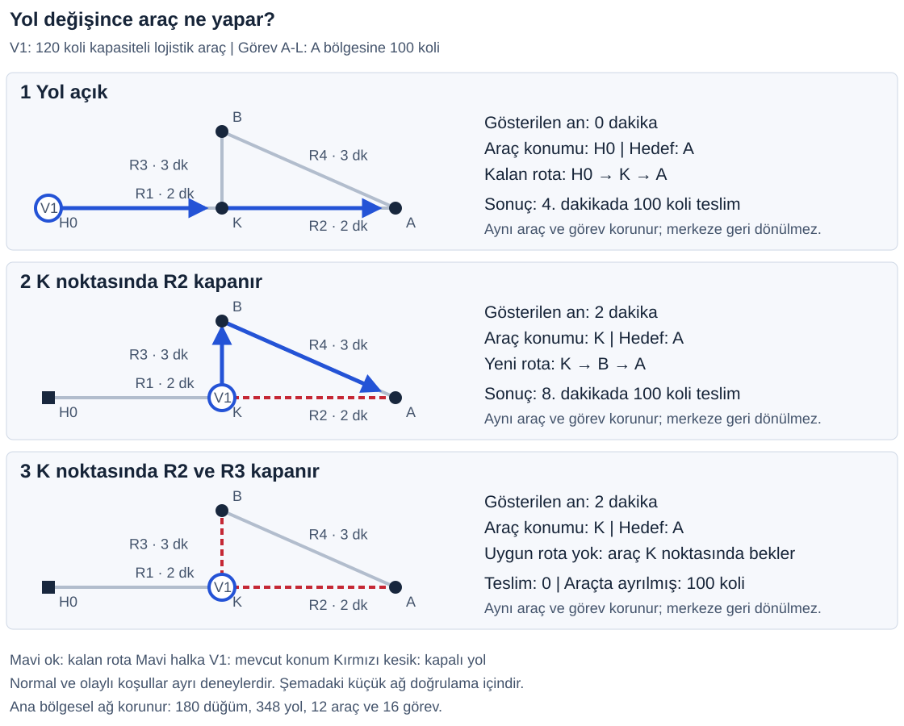
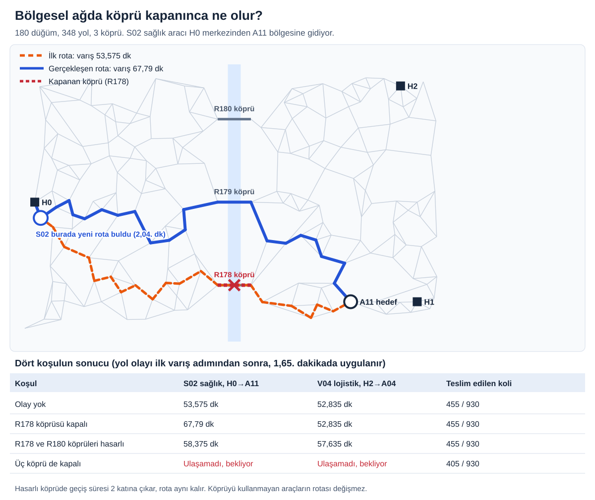

# Düğüm adımlı araç simülasyonu

7. hafta, 6. haftanın araç-görev eşleşmelerini zaman içinde yürütür. Araç çıkış merkezi, son ulaştığı düğüm, üzerinde bulunduğu yol, hedefi, kalan rotası ve varış zamanı birlikte izlenir. Lojistik yük yalnız hedefe varıldığında teslim edilir. Sağlık ve kurtarmada yalnız ekibin bölgeye ulaştığı kaydedilir; tedavi, tahliye veya kurtarma başarısı hesaplanmaz.

## Hızlı deney

Proje kökünde Python 3.11 veya daha yeni bir sürümle:

```powershell
py -3.11 scripts/run_simulation_examples.py
```

Bu komut `output/hafta7/` içinde küçük ağdaki üç koşulun, bölgesel ağın ve bölgesel ağdaki üç köprü olayının ayrı JSON kayıtlarını, kısa sonuç özetini, `simulasyon.svg` ve `bolgesel_kopru.svg` görsellerini üretir. SVG tarayıcıda açılır. Canlı animasyon değildir; motorun gerçek kontrol noktalarından üretilmiş üç açıklayıcı durum görüntüsüdür.



Küçük örnekte V1, H0 merkezinden A bölgesine 100 koli götürür. H0-K ve K-A yolları ikişer dakikadır. K-B ve B-A yolları üçer dakikadır.

- **Normal:** H0-K-A rotası 4 dakika sürer; varışta 100 koli teslim edilir.
- **Yol kapanması:** V1, 2. dakikada K'ye ulaşınca R2 kapanır. K-B-A rotası hesaplanır; toplam varış 8 dakikadır. Araç ve görev değişmez.
- **İzolasyon:** Aynı noktada R2 ve R3 birlikte kapanır. V1, K'de bekler. Teslim 0, araçta ayrılmış yük 100, kalan ihtiyaç 100 kolidir. H0'a dönüş hedefe ulaşmayı sağlamadığı için seçilmez.
- **Bölgesel ağ:** Yol olayı olmadan 180 düğüm, 348 yol, 12 araç ve 16 görev kullanılır. 11 araç hedefine ulaşır: 7 lojistik görevde 455 koli teslim edilir, 2 sağlık ve 2 kurtarma ekibi ulaşır. 475 koli ve 5 görev atanmamış kalır. Son varış 53,575. dakikadadır; V05 müsait değildir. Bu zaman 93 düğüme-varış adımıyla hesaplanır; 93 dakika değildir.

Tekrarlanabilir özet: [Deney sonuçları](deneyler/hafta7_sonuclar.json). Küçük ağ ana senaryonun yerine geçmez; sonucu elle denetlenebilen doğrulama örneğidir. İki ağın sonuçları birbirine karıştırılmaz.

## Tek koşulu çalıştırma

Varsayılan bölgesel ağ:

```powershell
py -3.11 -m ayros.simulate --json output/hafta7_bolgesel.json
```

Kapanma örneği:

```powershell
py -3.11 -m ayros.simulate --scenario data/hafta7_mikro_ag.json --fleet data/hafta7_mikro_arac.json --events data/hafta7_yol_kapanmasi.json --json output/hafta7_kapanma.json
```

`--steps 1` ile ilk varış adımında durulur. Bu adıma bağlı yol olayı varsa durmadan önce uygulanır. `--algorithm dijkstra` alternatif rota algoritmasını, `--damage-factor 2` hasarlı yol katsayısını seçer. Normal koşul için `--events` kaldırılır; izolasyon için `data/hafta7_yol_izolasyon.json` kullanılır.

## Bölgesel ağda köprü olayları

Küçük ağdaki kurallar büyük ağda da sınandı. Bölgesel ağda nehri geçen üç köprü (R178, R179, R180) vardır. Yol olayı ilk varış adımından sonra, 1,65. dakikada uygulanır. Aynı 12 araçlı plan dört koşulda yürütülür:

| Koşul | Olay dosyası | S02 sağlık, H0→A11 | V04 lojistik, H2→A04 | Teslim |
|---|---|---|---|---|
| Olay yok | - | 53,575 dk | 52,835 dk | 455 / 930 koli |
| R178 kapalı | `hafta7_bolgesel_kopru_kapanmasi.json` | 67,79 dk (yeni rota) | 52,835 dk | 455 / 930 koli |
| R178 ve R180 hasarlı | `hafta7_bolgesel_kopruler_hasarli.json` | 58,375 dk | 57,635 dk | 455 / 930 koli |
| Üç köprü kapalı | `hafta7_bolgesel_tum_kopruler_kapali.json` | Ulaşamadı, bekliyor | Ulaşamadı, bekliyor | 405 / 930 koli |

- **Tek köprü kapanınca:** R178'i kullanan tek araç S02'dir. S02 bulunduğu yolu bitirir, 2,04. dakikada vardığı düğümden R179 üzerinden yeni rota bulur. Varış 14,2 dakika gecikir. Köprüyü kullanmayan 10 aracın varış zamanı değişmez.
- **Köprüler hasarlıysa:** Köprü geçişi 4,8 dakikadan 9,6 dakikaya çıkar. Alternatif rotalar daha uzun olduğu için rota aynı kalır; S02 ve V04 4,8 dakika gecikir.
- **Üç köprü kapanınca:** Nehrin iki yakası ayrılır. S02 ve V04 bekler. V04'teki 50 koli araçta ayrılmış kalır, teslim sayılmaz. A11'e sağlık ekibi ulaşamaz.



Tek koşulu çalıştırmak için:

```powershell
py -3.11 -m ayros.simulate --events data/hafta7_bolgesel_kopru_kapanmasi.json --json output/hafta7_kopru.json
```

## Zaman ve olay kuralları

`Simulation.step()` tüm filoyu sıradaki düğüme-varış zamanına taşır. Her araç kendi yol süresine göre ilerler; farklı uzunluktaki yollar tek bir dakika sayılmaz. Aynı anda ulaşan araçlar kimlik sırasıyla işlenir. Yol üstündeki aracın son düğümü `node`, aktif yolu `edge_id`, varacağı düğüm `next_node` alanındadır. `eta_min` başlangıca göre tahmini varış dakikasıdır. `completed_distance_km` yalnız tamamen geçilmiş yolların mesafesidir.

Olay dosyasındaki `after_step` dakika değil, tamamlanan varış adımıdır; 0 başlangıçtır. Bir adımdaki birden fazla değişiklik aynı `changes` nesnesinde gönderilir. `open`, `damaged`, `closed` desteklenir. Olay grubu önce doğrulanır; tek bir geçersiz değişiklikte grubun tamamı reddedilir. Yol ve araç durumları ile günlük birlikte korunur.

Üzerinde araç bulunan yol değiştirilemez. Araç başka bir yoldayken ilerideki rotası etkilenirse aktif yolunu bitirir ve ulaştığı düğümden yeniden hesaplar. Bu sırada `reroute_pending=true`, tahmini varış bilinmediğinden `eta_min=null` olur. Etkilenmeyen araç aynı rotasını korur. Yeniden planlama görevleri başka araçlara dağıtmaz.

Alternatif rota bulunamazsa araç `blocked` olur. Motorun `change_roads()` metodu ile erişim yeniden açıldığında bekleyen araç tekrar rota arar. Bütün araçlar durduysa zaman kendiliğinden ilerlemez. Dolayısıyla ilerideki bir varış adımına bağlanmış açılma olayı beklemeyi çözmez; böyle bir CLI senaryosu açık hata verir. Bu sürümde süreye bağlı bekleme/olay kuyruğu yoktur. Aynı düğüm kontrol noktasındaki açılmayı Python API'siyle uygulamak mümkündür.

## Miktarlar ve sınırlar

Lojistikte `istenen = teslim edilmiş + araca ayrılmış + atanmamış` eşitliği her durumda korunur. `remaining` teslim edilmemiş toplamdır; ayrılmış ve atanmamış miktarların toplamıdır. Bekleyen araçtaki yük teslim değildir. Aynı varış yeniden işlenmez; bitmiş simülasyonu tekrar ilerletmek miktarı değiştirmez. Sağlık/kurtarma birimi ekip olduğundan koli toplamlarına katılmaz.

Atama başlangıçta bir kez yapılır; araç başına tek görev, görev başına tek araç, tam talep ve eski kapasite kuralları korunur. Başlangıçta atanmayan görevler, yol sonradan açılsa bile bu sürümde yeniden atanmaz. Varış sonrası ikinci sefer, depodan yeniden yükleme ve kısmi teslimat yoktur. Açgözlü atama tüm filonun küresel optimumunu garanti etmez. Yol yeniden açıldığında halen geçerli, etkilenmemiş rotalar sırf daha kısa yol bulunabilir diye tekrar hesaplanmaz.

## Kod ve doğrulama

- `ayros/simulation.py`: durum geçişleri, zaman, yeniden rota ve miktar hesabı; dosya/ekran işlemi içermez.
- `ayros/simulate.py`: olay girdisi, CLI, Türkçe özet ve JSON; hesapları motor üzerinden çalıştırır.
- `scripts/run_simulation_examples.py`: sabit deneyler ve kontrol noktalarından SVG; teslimat mantığını yeniden uygulamaz.
- `tests/test_simulation.py`: 24 test; normal/alternatif/engellenen rota, tekrar varış, açılma, veri sırası, farklı hizmetler, zamanlama, hata sonrası durumun korunması, girdi koruması, tekrarlanabilirlik, bölgesel ağda köprü kapanması/hasarı/izolasyonu ve yayımlanan deney kayıtlarının yeniden üretimle birebir eşleşmesi.

Tam test kümesi 149 test metodudur. Testler her gönderimde GitHub Actions üzerinde Windows ve Linux, Python 3.11 ve 3.13 ile çalışır. JSON çıktısı girdi SHA-256 değerlerini içerir. Çalışma zamanı veya hazırlanma tarihi eklenmediği için aynı girdiler aynı kaydı üretir. Bu sonuçlar sentetik senaryo doğrulamasıdır; saha başarısı ölçümü değildir.

## Kısa sunum akışı

“Geçen hafta hangi aracın hangi göreve atanacağını planladık. Bu hafta bu planı zaman içinde yürüttük. Araç hedefe varmadan yükü teslim saymıyoruz. Küçük örnekte normal yol 4 dakika sürüyor. Araç K'ye ulaşınca yol kapanırsa bulunduğu yerden alternatif rota buluyor ve 8. dakikada ulaşıyor. İki yol da kapalıysa bekliyor; 100 koli araçta kalıyor. Aynı motoru büyük ağda da çalıştırdık: R178 köprüsü kapanınca yalnız o köprüyü kullanan sağlık aracı yeniden rota buluyor ve 14 dakika gecikiyor; üç köprü birden kapanırsa nehrin öbür yakasına ulaşılamıyor. Bir sonraki hafta bu durumu haritaya bağlayıp kısmi teslimat kararını karşılaştıracağız.”
